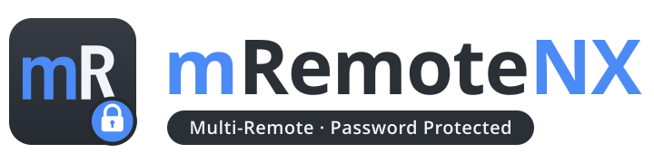

<p align="center">
  
</p>

# mRemoteNX

mRemoteNX is a password-protected fork of [mRemoteNG](https://github.com/mRemoteNG/mRemoteNG), the open-source
multi-protocol remote connections manager (RDP, VNC, SSH, Telnet, HTTP/HTTPS, rlogin, raw sockets, PowerShell and more).
It is based on the [mRemoteNG Community Edition](https://github.com/robertpopa22/mRemoteNG) and runs as a separate
application, side by side with any installed mRemoteNG.

- Main repository: <https://gitea.mykino.uk/mishka1c/mRemoteNX>
- GitHub mirror and builds: <https://github.com/mishka1c/mRemoteNX>

## What mRemoteNX adds

| Feature | Details |
|---|---|
| Application password | One password unlocks the application. It is also the master password of the connections file. |
| Encrypted connections file | The whole connections file is always encrypted with AES-256-GCM; the key is derived from the password with PBKDF2 (600,000 iterations by default). |
| First start | If the connections file has no master password yet, mRemoteNX asks you to create one, or exits. |
| Attempt limit | After 15 wrong passwords in a row the application closes (configurable, 1-100). |
| Idle lock | After 15 minutes without input the window locks and hides to the tray (configurable, 0 = off). |
| Separate application | Own settings folders, installer, start-menu entries, registry policy key and single-instance lock; does not touch an installed mRemoteNG. |
| Updates | The in-app update check uses only this repository's releases. |

The settings are under **File → Options → Security → Application password (mRemotePass)**.

> The password cannot be recovered. If it is lost, the saved connections cannot be decrypted.
> Keep a backup of `confCons.xml` before the first start.

## Moving connections from mRemoteNG

mRemoteNX does not read mRemoteNG's settings. Open a copy of your `confCons.xml` with **File → Open Connection File**
(or import it). On first start mRemoteNX asks for a password and saves the file fully encrypted.

## Downloads

Builds are published under [Releases](https://github.com/mishka1c/mRemoteNX/releases). They are not code-signed,
so Windows SmartScreen may warn on first start (**More info → Run anyway**).

## Building

The solution needs Visual Studio 2026 (or Build Tools) with MSBuild; `dotnet build` alone cannot build the RDP
ActiveX (COM) reference.

```powershell
pwsh -NoProfile -ExecutionPolicy Bypass -File .\build.ps1
```

On GitHub the builds run on demand: **Actions → Nightly Build / PR_Validation → Run workflow**.
Pushing a tag such as `v1.85.0` runs the release build.

## License and credits

mRemoteNX is licensed under the [GNU General Public License v2](COPYING.txt), like mRemoteNG.
It is built on the work of the mRemoteNG team and of the mRemoteNG Community Edition maintainers.
The original project README is kept in [docs/UPSTREAM-README.md](docs/UPSTREAM-README.md).
